# FreeRTOS

## 基础知识

1.RTOS是“实时操作系统”的统称，它的作用是通过快速切换任务达到多任务同步并行的伪效果及其他任务调度效果，FreeRTOS是目前全世界用的最多，最火的开源免费RTOS。

CMSIS是ARM公司搞出来的一种标准。

不同的RTOS函数不一样，但接上CMSIS-OS接口，就变成了使用CMSIS-OS提供的函数，统一了。

CMSIS-OS包装了大部分的基础功能，但一些高阶操作还是用FreeRTOS的原生函数才能做到。

下面对于CMSIS能实现的操作我们就学习CMSIS

在Cube MX  ->  Middleware and Software Packs  ->  FREERTOS中选CMSIS_V2，就成功用MX配置了FreeRTOS和CMSIS-OS接口

2.SysTick是ARM内核自带的定时器，每1ms产生一次中断。

HAL库默认靠它实现HAL_Delay()和HAL_GetTick().

而FreeRTOS的任务调度器强制使用SysTick，对其的设置（改它优先级）可能会影响到工程

我们可以把工程本身的时钟基准源换掉，SysTick让出来转给RTOS,systick不在时钟树里直接调试，它总是默认为1ms

在SYS中把Timebase Source从SysTick换成一个没用的定时器，通常用TIM4，因为它功能最少，被占用了损失最小

3.若使用FreeRTOS，进入Clion，在main.c中可看到函数

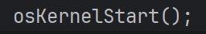

代码从main（）开始运行，运行至此函数时便进入Free RTOS的接管，开始按规则运行任务

4.知识点目录

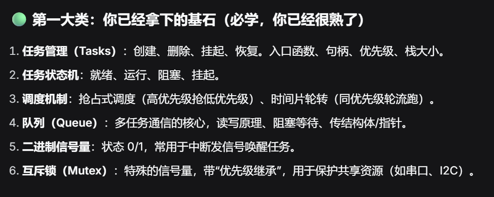

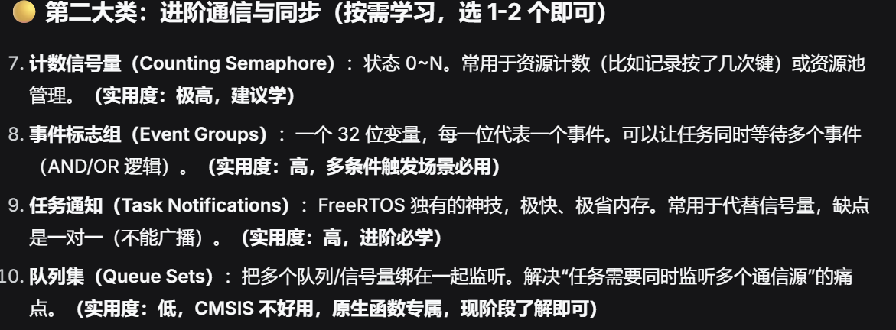

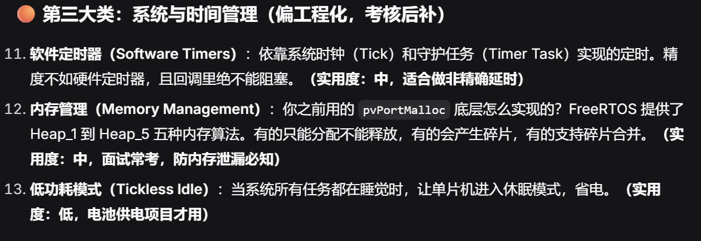

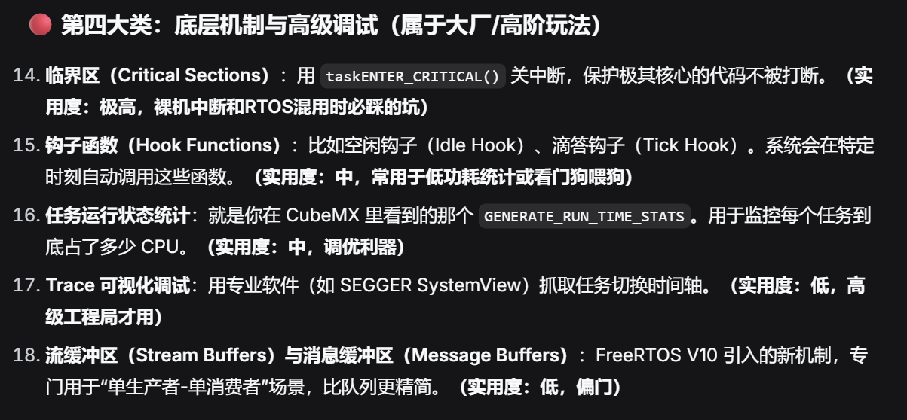

下面我们正式开始学习

## 创建任务

在MX的FreeRTOS界面有Tasks and Queues，在Tasks框里点Add，出现如下界面

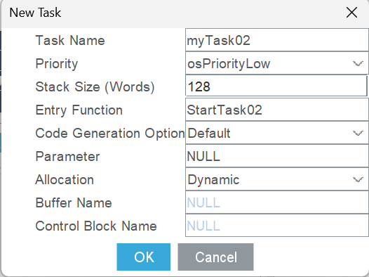

依次是：

**任务名**

**优先级**

**栈大小（单位字节）**

**入口函数名**

**代码生成选项，不用管**

**要传输的参数（一般用不到）**

**内存分配方式，一般不用管**

**缓冲区名称**

**控制块名称**

我们将在后面的学习中逐步认识这些参数

CubeMX会给我们一个默认任务，双击已有任务可以打开参数界面

对于已创建的任务，

我们以如下任务为例：

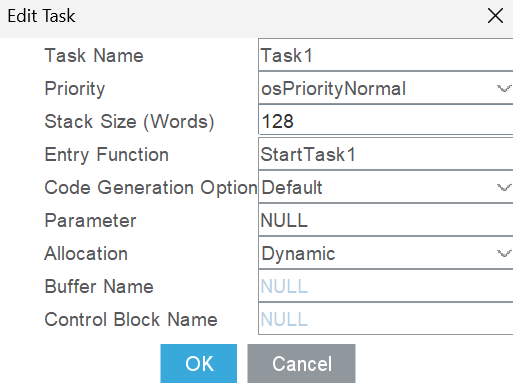

打开Clion，在FreeRTOS.c中可以看到MX生成了

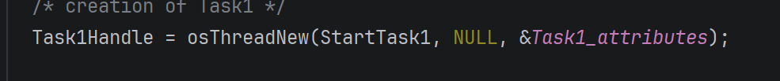

这句代码规定了如下事项：

前面的Task1Handle就是这个任务的操作句柄了，后面要操作此任务时，这个句柄就是对应任务的代称（句柄的起名规则就是“任务名+Handle”）

后面是一个OS接口提供的任务创建函数（后面的大部分都是，就不再说了），参数是我们在MX中设置过的：第一个参数是入口函数名，第二个参数是要传输的参数，第三个是一个结构体，ctrl点击来到结构体定义：

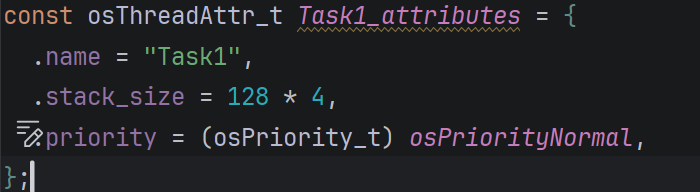

里面放着任务名，栈大小，和优先级

往下翻

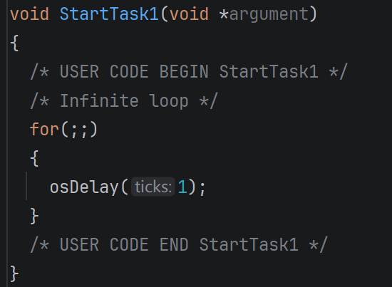

这就是入口函数本数了，任务的代码就放在这个for循环里，就像放在main函数的while循环里

## 任务切换的基本原理

代码编译的指令烧录在Flash中

而CPU只能对寄存器进行操作运算

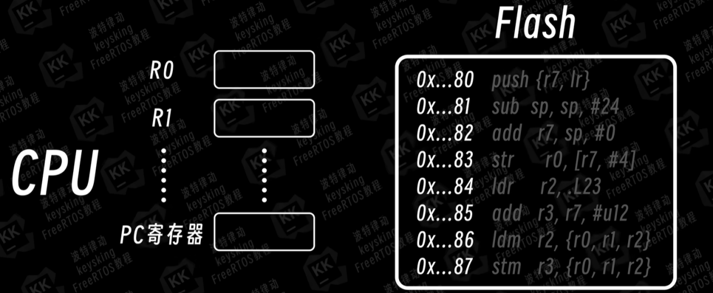

每个任务都有对应的任务栈，栈的大小我们在创建任务时已经设定，

假设现在有AB两任务

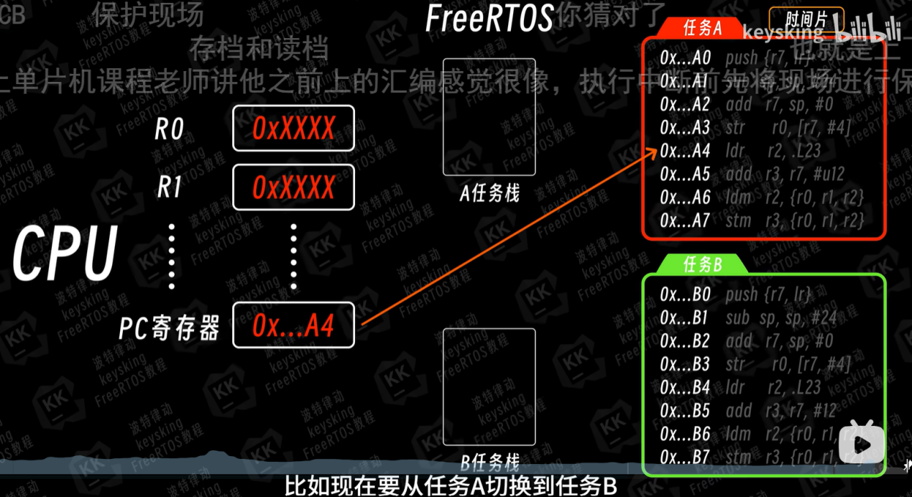

原本A在运行，此时该切换至B任务了，寄存器中的数据就会转进A任务栈，空出地方给任务B：

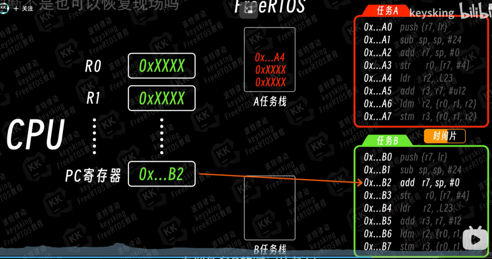

这样就完成了任务切换，耶✌！

任务的切换依赖于PendSV中断，其优先级是最低的（15）

## 任务的4种状态

在FreeRTOS的调度下，任务可以有4种状态：

**就绪态，运行态，阻塞态，挂起态**

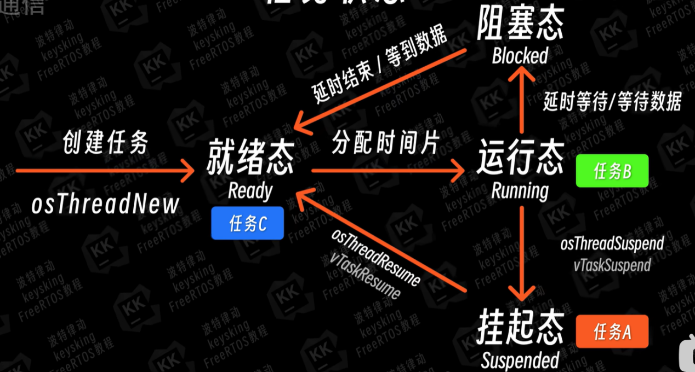

一开始所有任务都在就绪态，从其他三态出来的任务都进入就绪态。

当没有任务在运行态时，系统在就绪态里根据规则判断该谁运行，谁就开始运行，即进入了运行态。

### 阻塞态

当任务需要延时等待或等待数据时，进入阻塞态，处于阻塞态的任务不占用CPU

1.osDelay函数

在学osDelay前，我们先回头看一下HAL_Delay函数，HAL_Delay的本质是用HAL_GetTick一直检测是否达到时间，也就一直占用着CPU，

非常的垃圾，在任务中我们要避免使用HAL_Delay

osDelay（）函数就是让任务进入阻塞态一定时间，括号内填数字，单位tick(1tick通常是1ms，tick可以在代码里手动改变)

x.其他阻塞情况在下面的学习中我们会逐步遇到

### 挂起态

用函数

将函数挂起

参数是任务操作句柄（图中是挂起任务Task1）

可以由自己挂起，也可以由其他函数挂起

用函数

将函数回复至就绪态

## 任务的调度

抢占式调度和时间片轮转都是默认开启的且很少有需要关闭的情况，这里说一下只是让你知道这些是可以关闭的，下面我们只介绍开启时的规则，未开启的情况自己了解去。

当抢占式调度开启时，可以保证：任何时刻在运行态的任务的优先级都大于等于就绪态里的任务的优先级，

比如当一个高优先级任务从阻塞态出来，会直接踹走正在运行的低优先级任务然后自己开始运行。

FreeRTOS的优先级默认有56个，0~55，与STM32自己的相反，FreeRTOS是数字越大，代表优先级越高，每个数字对应一个名字，像这样：

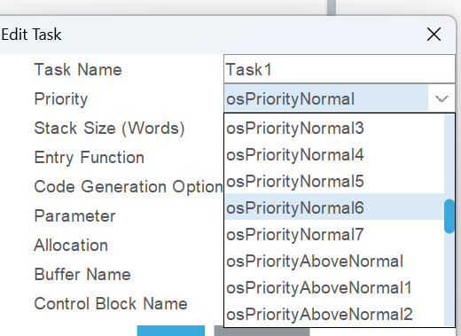

当时间片轮转开启时，若有多个同级任务，调度器会轮流分配时间片，一个时间片是一个tick（1tick通常是1ms，可以手动改变tick），

一般就是轮流运行1ms，看起来就像同时运行。

也存在一些操作可以手动控制任务，比如函数osThreadYield——滚回就绪态，让出CPU；函数osThreadExit——本任务释放内存，原地去世，还有任务调度器挂起和恢复等，若有用到再自行了解。

## 队列与队列集

## 队列

### 队列的创建

用基本逻辑来传递信息会带来很多问题

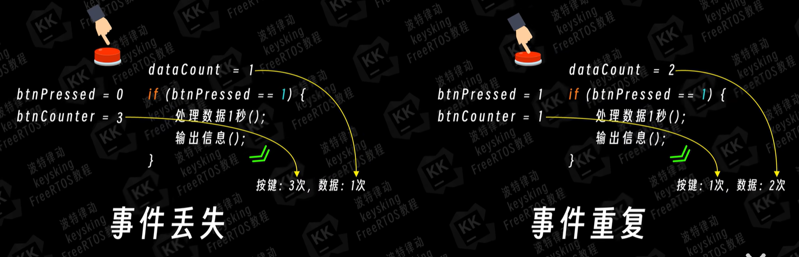

简单来说就是在处理数据时按下按钮，上次的数据没处理完呢就更新了，或者一直按着不松数据一直触发处理但数据根本没更新。

虽然再加一些if和变量或者换种逻辑结构能够解决这个问题，但那样太不优雅了😡，简直令人作呕。

我们可以用 队列 在任务间传递数据

在MX的FreeRTOS界面有Tasks and Queues，Queues就是队列，点击

Add，出现如下设置界面

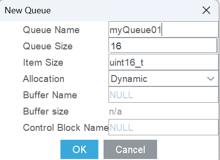

**队列名**

**队列大小（单位：个）**

**数据类型（一个队列只能传输一种数据）**

**内存分配方式（一般不动）**

**缓冲区名称**

**缓冲区大小**

**控制块名称**

创建完毕来到Clion，MX生成了

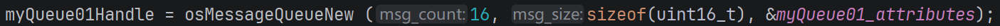

呃有点太小了我分两段截

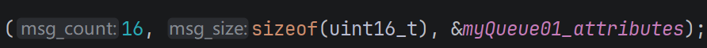

类比任务的创建：等号前面就是队列操作句柄，命名规则是队列名+Handle，等号后面是队列创建函数，参数依次是队列长度，每项信息的长度，结构体

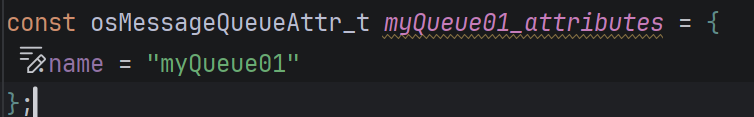

里面只放了个队列名😅

### 队列的使用

用函数osMessageQueuePut（）向队列写入数据

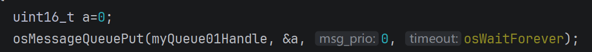

参数依次是队列句柄，要传输的变量的指针，第三个参数对FreeRTOS没用，填0或NULL即可，最后一个是等待时间。

等待时间写0：若此时队列已满，则直接丢掉此数据，向下运行

写一个正整数n：若此时队列已满，进入阻塞态n毫秒（不是tick），若期间队列出现空位，就自动回到就绪态（不一定能立刻发送哦，杂鱼~）

还能填图中的osWaitForever，表示若队列已满就永久等待，直至出现空位回到就绪态

用函数osMessageQueueGet（）从队列拿走数据

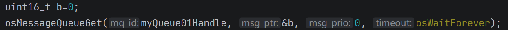

（看不清的话ctrl+鼠标滚轮可放大缩小）

参数依次是队列句柄，存数据的变量的指针，第三个参数依旧没用，填0或NULL，最后是等待时间

填0：若队中没有数据直接跳过

填数：若无数据进入阻塞态等待x毫秒

osWaitForever:若无数据永久等待

细节类比写入函数

### 用队列传输结构体

一个队列只能传输一种类型，若我们想传输多个数据，可以传输结构体，我们通过泛性例子来学习：

背景：要求按下按钮，处理此次数据（处理需要时间），按几次就要输出几次结果

创建结构体struct a

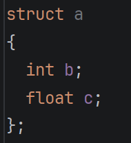

通常结构体的大小都比较大，例子中int，float都是32位，加起来64位，比STM32的32位指针大，所以在传输结构体时通常传输他的指针，如图，数据类型是struct a*（结构体struct a的指针类型）

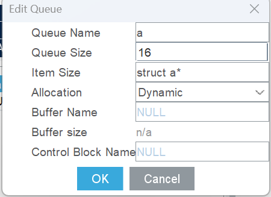

下面我们创建一个struct a变量a1和一个指针变量用于存放a1的指针

struct a*  pa1 = \&a1。。。。。。吗？

此处较为复杂且涉及知识较多较散，请看文件夹内视频12：18~16：18（keysking的B站视频），当然欢迎你从头看到尾

在这里我们简单解释：

直接传输指针变量，很容易造成野指针：

比如如果是局部变量（每次重新定义），有可能在轮到处理这个数据前，就出大括号了，内存就被释放了，鬼知道轮到处理它的时候这个地址又被用来干嘛了。

如果是全局变量，只在循环里改这个变量的参数，则传的永远是同一个地址，在轮到处理这个数据前很可能就被下一轮数据覆盖掉了，因为都要存在同一个地址。

总之，我们需要人工控制内存的调用，不能放任输入函数只管发出去，不保证数据能活到被使用的不负责任的做法。

因此，我们需要用FreeRTOS的专属malloc函数：pvPortMalloc()来动态申请内存，数据处理完完再vPortFree()释放。

这时我们会发现根本无需a1变量，直接

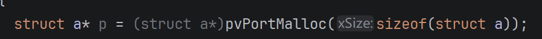

然后对地址p直接操作

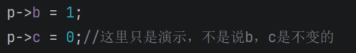

然后传p（参数是对p取地址）

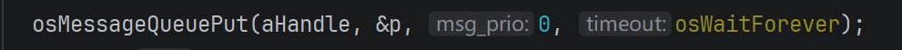

最后，别忘了在数据处理函数最后记得Free掉申请的内存！

## *FreeRTOS里的中断-队列

建议看一遍对应视频19：27~20：52（也是keysking的）

中断不属于FreeRTOS的任务，所以中断必须用时尽量短。

在中断里使用队列发送函数时超时时间必须为零，否则不予执行。

## 队列集

CMSIS OS接口并未实现队列集相应函数的封装，且队列集本身似乎使用较少，我们暂时跳过

**信号量**

## 信号量本质是元素长度为0的队列，二进制的队列长度为1，计数的长度为n

## 二进制信号量

## MX - FreeRTOS - Timers and Semaphores中的 Binary Semaphores是二进制信号量的地方，点击Add

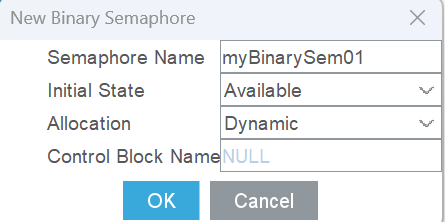

**名字**

**初始状态**   分为Available（初始就能被获取一次）和Depleted（初始为空）

**内存分配方式**

**控制块名称**

进入Clion，多了

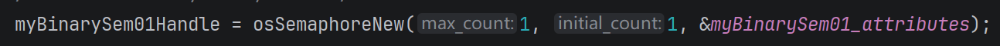

类比任务和队列，前面是句柄，后面是创建函数，参数：

最大量，初始值，信息结构体。都不用管。

用函数

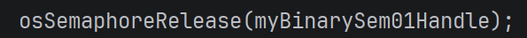

释放信号量，使为空的二进制信号量变为可获得

用函数

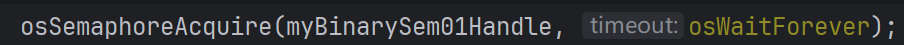

试图获取信号量，参数：

信号量句柄，等待时长。

功能不用我解释了吧宝子

## 计数信号量

## MX - FreeRTOS - Timers and Semaphores中的 Counting Semaphores是二进制信号量的地方，点击Add

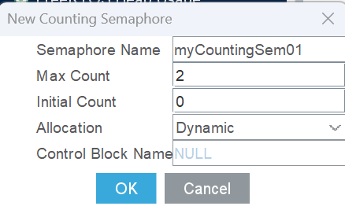

**名字**

**最大信号数量**

**初始信号数量**

**内存分配方式**

**控制块名称**

进入Clion，多了

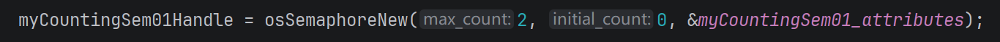

略

与二进制相同，用函数

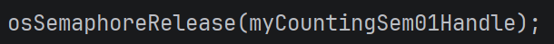

释放信号量，使可获得的信号量+1（除非已经满了）

用函数

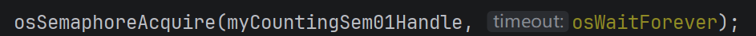

试图获取信号量

信号量常用于请求排队和资源管理，请求排队就是订单放这了，你慢慢处理，资源管理就是规定初始信号量=资源量（比如串口的占用），用的拿走一个信号量，用完了再释放一个信号量

**互斥锁**

互斥锁存在的意义（为了解决什么问题）及其作用见视频-互斥锁（我懒得记了）

MX - FreeRTOS - Mutesxes中的 Mutesxes一栏是互斥锁，Add

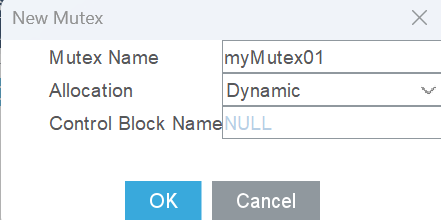

各选项能看出来是啥了吧

出现

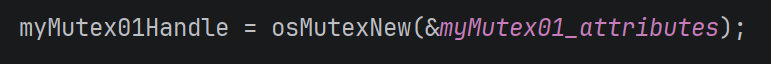

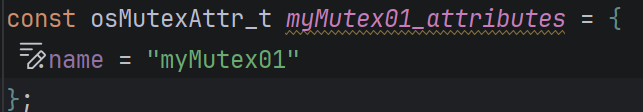

释放函数

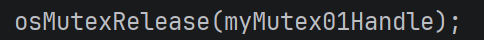

获取函数

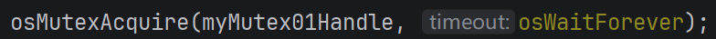

**事件标志组**

事件标志组是一个公共信息板，它本质上是一个32位整数，其中24位用来传递信息，高8位（24~~31）用来存储事件标志组的控制信息，我们通过函数改变0~~23位的01信息，用Bit0~23代表这些位。

在FreeRTOS的Events版块新建事件标志组，出现

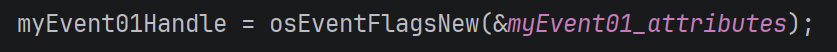

## 向事件组写入

存在函数

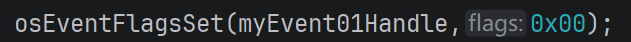

“向目标事件组的目标标志位写入1”

和函数

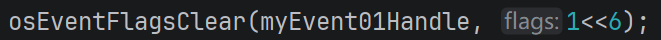

“向目标事件组的目标标志位写入0”

这两个函数参数相同，

参数一是句柄，参数二是目标标志位（本质掩码）

这里标志位本质是32位数，有很多种表示方法，你只要写的是个数就行，把这个数转成二进制，对为1的对应位操作。（不要操作高8位！）

常用下面两种表示方式：

### 十六进制表示

可以用16进制表示，将其转化成二进制数，哪些位是1就对对应的位操作

比如填0x00，二进制就是0，没有位被操作，无事发生

填0x01，二进制：1，Bit0被操作（写入1）

| 填入            | 转成二进制                    | 结果              |
| ------------- | ------------------------ | --------------- |
| 0x03（可以写成0x3） | 11                       | Bit0，Bit1被写入1   |
| 0x08          | 1000                     | Bit3被写入1        |
| 0x18          | 10010                    | Bit4，Bit1被写入1   |
| 0xC40000      | 110001000000000000000000 | Bit23,22,18被写入1 |

### 不如移位符方便，你知道有人喜欢这么表示你能读懂就行了

### 用移位符表示

如果你忘了什么是移位符，去再学一遍（没来得及做笔记）

若想对Bit n操作，就1<<n（二进制000000...1所有数向左），比如

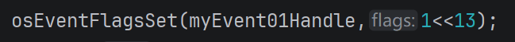

就是对Bit13操作(写入1)

### 按位或运算

|             |                |
| ----------- | -------------- |
| 我们可以用 按位或 “ | ”（按位或就是二进制的相加） |

来同时对多个标志位操作：

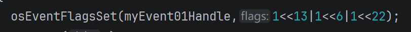

就是对Bit13，Bit6，Bit22操作

|               |                              |
| ------------- | ---------------------------- |
| 注意：<< 的运算优先级比 | 高，所以这里可以不写括号，但是平常最好加上，加上是好习惯 |

## 用事件组信号触发行动

存在函数

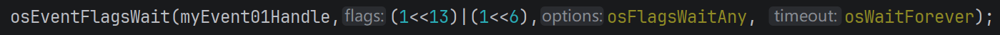

用于等待目标标志位，我们可以实现下面的效果：

在阻塞态等待目标标志位，直至等待时间结束。

可以同时给出多个标志位，并选择“任意一个标志位为1触发”还是“所有标志位都为一触发”。

触发后是否清除此标志位（置0）。

第一个参数是事件组句柄，

第二个是目标标志位（也叫掩码，跟写入函数的一样）（图中括号可以不加），

第三个用来选择模式，osFlagsWaitAll是所有指定标志位全部为1才放行，osFlagsWaitAny是任意一个指定标志位为1就放行，同时原生函数的参数3（指定是否清除）（原生函数有5个参数）被合并到了这里，默认是清除，若不想清除，就用按位或在后面加上osFlagsNoClear,如图：

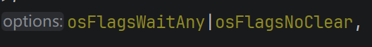

第四个等待时间，老熟人了，就不介绍了😋

## 获取当前事件组标志位状态

存在函数

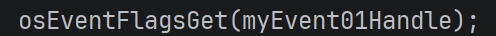

返回值是事件标志组这个32位二进制数本身（相当于查看了哪一位为1）

常与osEventFlagsClear配合，达到清除所有标志位的效果，如图：

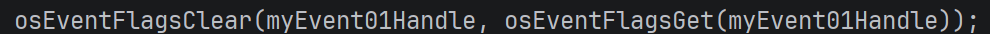

以上就是事件组部分常用的操作了，还有一些函数和操作没有提及，比如删除事件组函数，同步函数等，以后有用到再自行了解

## 任务通知（线程标志）

os封装版只实现了任务通知里的小部分功能，并改名为“线程标志”建议以后有时间学一下原生函数，这里为了赶时间先不学原生了，只学os函数

前面我们所学的队列，信号量，事件标志组本质上都是信号的通知与传递，FreeRTOS为我们提供了一个更灵活更直接的通知方式，就是任务通知，它占内存小，速度快，所以很多时候用它来替代前面那些高级方式，劣势就是功能简单，有时做不到那些高级方式能做到的事。

对于os的阉割版任务通知（线程标志）：

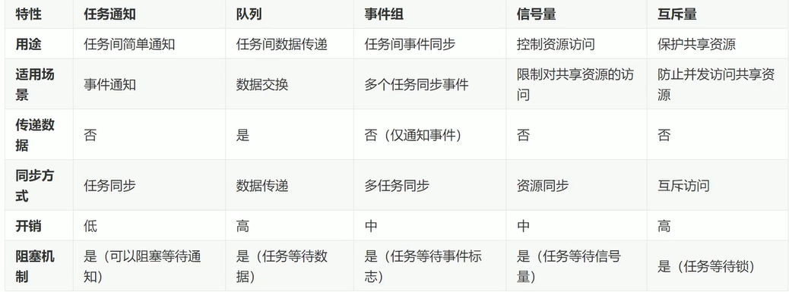

线程通知和事件标志组很像，不过线程标志只能1对1通信，把他比作私人信箱是一种很好的理解方式。

它是一种操作，无需创建，每个任务天生自带一个32位变量。

用函数

发送信号（操作目标任务的32位变量，将对应位置1）

什么你问为什么没介绍参数？你前面学的是狗屎吗😡

用函数

等待信号，

参数的意义与操作 与事件组完全一样

用函数

操作自己的对应位（置0）

什么？为什么不能清除别人的标志？

你闲的没事动人家私人信箱干什么😡，真想清除去找原生函数去😡，这里不欢迎你这种没有素质的人！😡

**临界区**

又常被称为临界段，是用于保护绝对不能被打断，必须一口气处理完才行的任务，本质上就是暂时关闭所有中断，所以临界段里的耗时必须极短，不然可能会造成严重的后果。

os接口没有封装相关函数，因为太简单了没有必要，我们直接使用FreeRTOS原生的宏

### 在任务里关闭中断

中断关闭宏：

中断开启宏：

（注意分号哦❤️）

将要保护的代码写在他们中间即可，最好用大括号括上，像这样：

### 在中断（回调函数）里关闭中断

在中断里关闭中断前，要先记录当前中断状态，原因你再自己去了解吧，这里没时间记了。

函数和格式在示例里，自己看

示例：

**软件定时器**

硬件定时器的数量是有限的，我们可以使用软件定时器。

软件定时器精度低，功能少，所以一般给精度要求不高的任务用软件定时器。

软件定时器的相关功能是由FreeRTOS自动创建的默认任务“软件定时器服务任务”实现的，相关API（就是函数）本质是通过默认存在的队列“软件定时器命令队列”向软件定时器服务任务发送命令从而实现效果的，软件定时器的回调函数由软件定时器服务任务调用，这是软件定时器的底层原理。

### 创建定时器

在Timers and Semaphores的Timers版块创建软件定时器

**名字**

**回调函数名**

**定时器类型**

有周期模式和单次模式，周期模式就是触发中断后重新计数，周期触发中断，单次模式就是只触发一次，触发后停止，相当于用了暂停函数。

**代码生成选项**

**（要传的）参数（一般用不到）**

**内存分配方式**

**控制块名称**

创建后出现

和

一个创建函数，一个回调函数空壳

### 常用相关API

**启动/重启定时器**：

参数1是定时器句柄，参数2是设置周期。

定时器创建后默认是暂停状态，要用此函数开始运行。

单次模式结束或使用暂停函数后可以用此函数重新启动。

计数中途可以用此函数归零从头计时。

**暂停函数**：

使计数暂停
