# SPI总线

在MX中点进SPIx，可选模式如下：

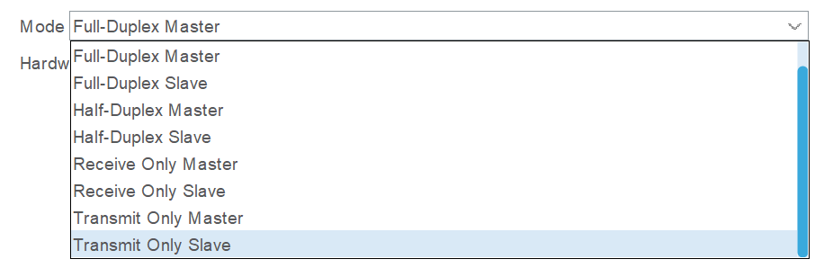

- 全双工主机模式
- 全双工从机模式
- 半双工主机模式
- 半双工从机模式
- 主机只收模式
- 从机只收模式
- 主机只发模式
- 从机只发模式

单片机做从机几乎不会用到，我们通常使用第一个模式。

## 硬件线路

下面讲一下硬件线路，

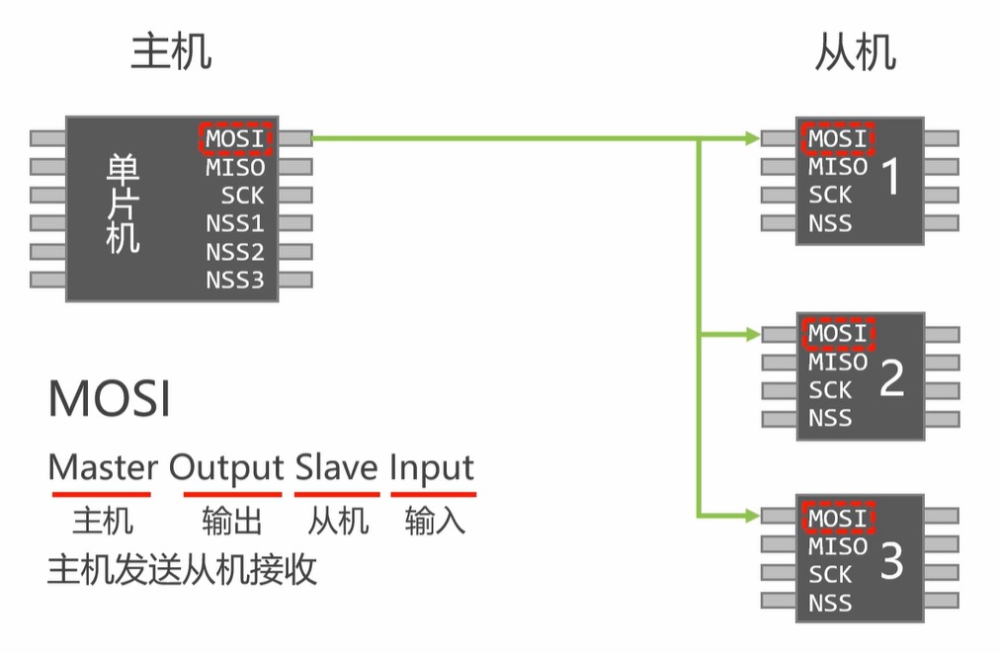

如图所示，主机有MOSI，MISO，SCK和从机个数个NSS，从机只有一个NSS。

MOSI是主机向从机发信息的线，主从机对应连接。

MISO是从机向主机发信息的线，主从机对应连接。

SCK是时钟线，主从机对应连接。

NSS是用来选择从机的线，摩托罗拉格式下（默认就是这个），当主机想要和某个从机通信，就将对应NSS置为低电平，NSS为低的从机才会开始读数据，有几个从机，主机就要有几个NSS对应相连。

在选择全双工模式后，MX自动为我们配置好部分引脚。

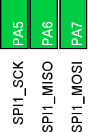

NSS由我们自己找空闲引脚用输出模式充当（默认NSS引脚类型选择Software（软件），这个在下面的高级选项里）。

## SPI 参数设置

下面让我们把目光移向设置界面

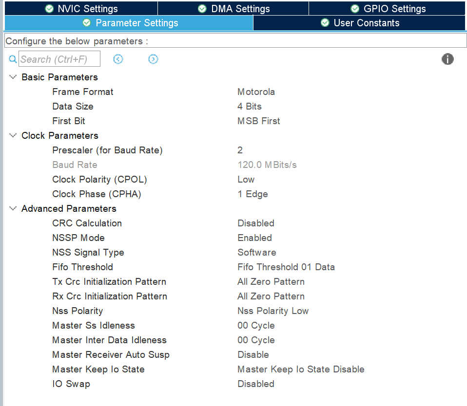

是基础设置，是用来对齐从机的规定的。

第一行是选择格式，默认摩托罗拉，不用管。

第二行是数据位长度，根据从机选择（去看从机的芯片手册），这个是配合从机的断句的，从机规定每几个bit作为一个数据读出主机就要选几，8位最常见。（只用管8位和16位，其他乱七八糟的位数不用管，根本没有适配）

**扩展：**

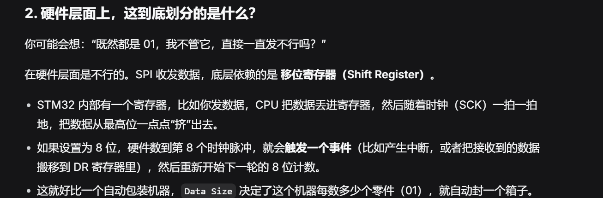

第三个是数据发送方式，也是看从机怎么要求，高位先发（MSB First）还是低位先发（LSB First），比如要发送数据13，若数据长度为8，转化成二进制是00001101，高位先发则按0，0，0，0，1，1，0，1的顺序发出，低位先发就是按1，0，1，1，0，0，0，0的顺序发出。

### 时钟设置

是时钟设置，

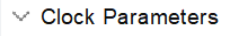

第一个是预分频，对谁分频呢，打开时钟树，如图

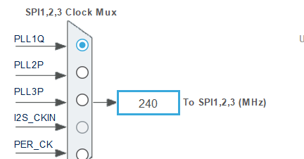

第二个是波特率，由上图频率分频后得到，在选择波特率时，要同时考虑到从机的承受能力（手册会提及），硬件电路的承受能力等，不能一味的拉最高。

第三个是时钟极性，SPI是同步通信，但只有在移位寄存器需要转的时候始终才会开始跳动，没有通信时默认状态可以选择低电平（Low）或高电平（High）。

第四个是时钟相位，就是选择在第一个跳变边沿时取样（1 Edge）还是在第二个跳变边沿取样（2 Edge）。

第三第四个选项共能有4种组合

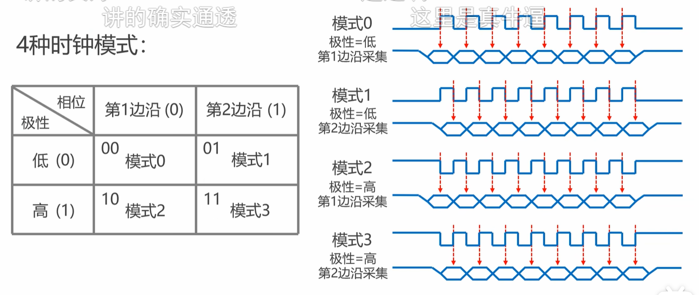

是根据从机选的，看从机能适配哪几种（看手册）。

再下面是高级选项，不用动就行，以后自行了解。

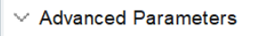

## 编写代码

配置完毕，该写代码啦！😋

### 阻塞式收发

我们先学最普通的阻塞式

#### 发送函数

首先是只发函数

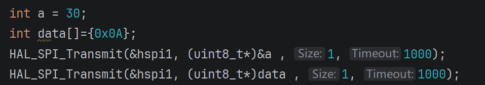

第一个参数是相应SPI的句柄，

第二个是要发的数据的指针，此函数的定义这里是uint8_t *,所以记得强制转换（截取的低8位）（也别忘了8bit最高只能到255），

第三个是要发的帧数，明显要发几个数据就是几帧嘛（这里帧的长度就是之前选的数据位长度），

第四个是超时时间，老朋友了。

#### 接收函数

然后是接收函数

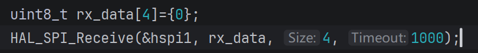

和发送函数很像，第二个参数是用来放接收到的数据的变量/数组的地址。

**注意1：**&#x8FD9;里接收数组必须是uint8_t类型的，因为函数定义第二个参数是uint8_t *类型。     那么能定义一个int数组然后在函数里填参时强行转换成uint8_t吗？不行，因为数组的数据类型只决定了在调用时如何断句，与写入无关，写入时数据会默认按本类型断句写入，新数据不会帮你自动跳到下一个数据应该在的位置，比如收到4个uint8_t就会塞进int的前四个字节（对应第一个数据位）。      总之，我们必须保证写入的数据的类型必须和数组本身类型相一致。

#### 同步收发函数

下面是最重要的用的最多的：同步收发函数

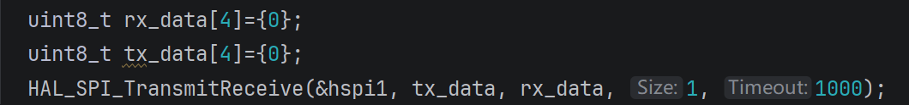

句柄，要发的，来收的，几个帧（收发同步的，这个既是发的帧数也是收的帧数），超时时间

这里就有的讲了

#### 为什么需要同步收发

我们先讲一下为什么要有这个同步收发函数：

通常，从机要接到主机发来的指令（读某个寄存器等）才会传回相应数据，指令通常为一字节，要传回的数据就会在紧接着的第二字节发来，若用收和发两个函数，函数之间的切换可能就会使时钟线数据线对不上，且只用收和发两个函数，就得发一字节收一字节，同步收发就可以一次通多个，在上一个数据传回时刚好发出下一个指令。

然后我们来做一下拓展：

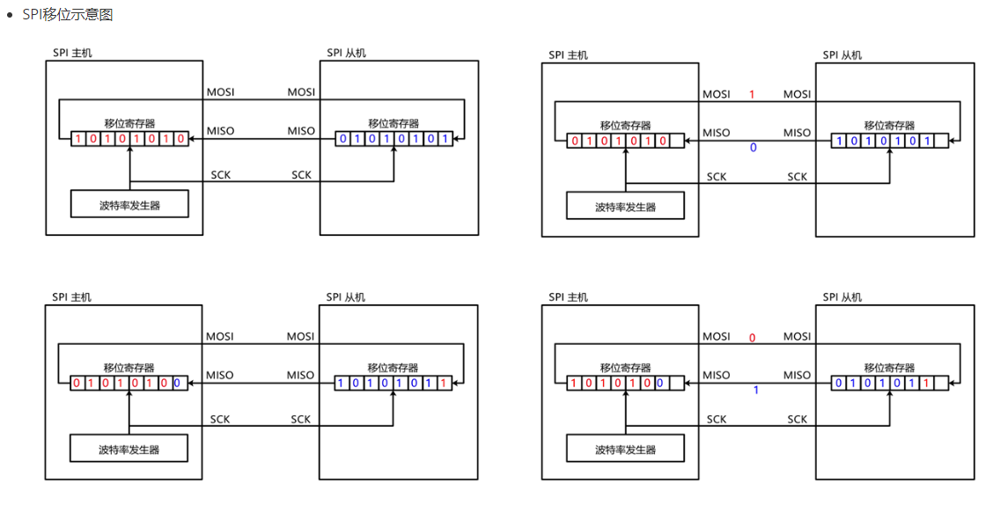

如图，SPI是只有一个8位寄存器的，像转圈一样收发同步，发一位就收一位，等收够8位就把数据放到相应内存。

## 中断方式

下面讲SPI的中断方式，有三种中断。

### 发送中断

我们先讲发送中断：

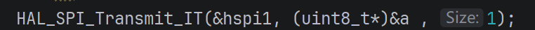

没有等待时间参数，这个函数是如此运行的：

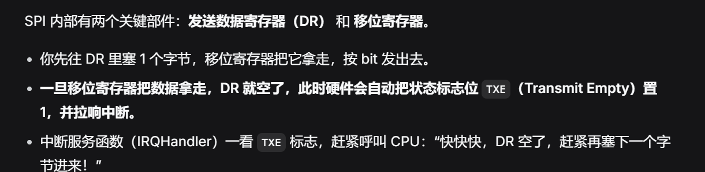

CPU不用一直被阻塞，可以节省出一部分时间处理其他任务。

若在MX中打开了他的中断，就会有一个中断回调函数（发送完成回调）

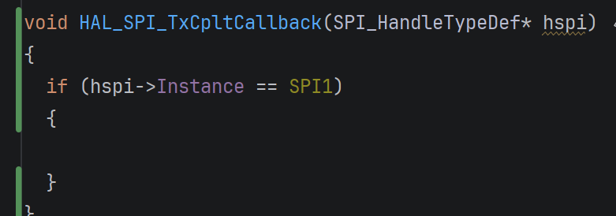

（当然要自己写）

这个回调函数会在全部数据发完后被调用。

### 接收中断

然后是接收中断

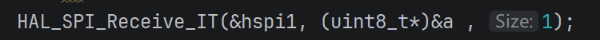

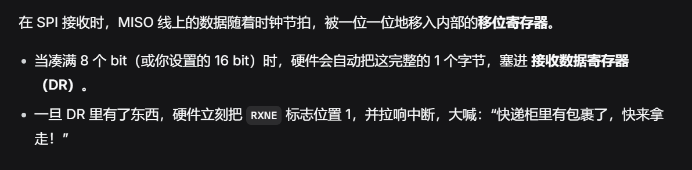

依旧有一个回调函数（接收完成回调）

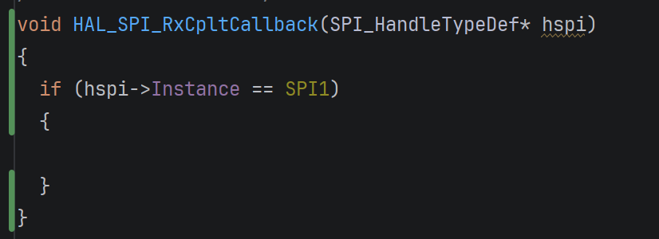

### 收发完成中断

最后是收发完成中断

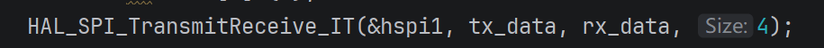

回调函数

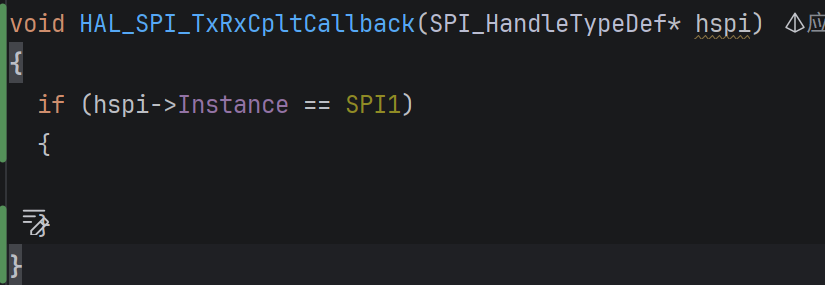

在收发完成后调用。

## DMA 方式

下面学习DMA方式

DMA是独立于CPU的一个硬件控制器，在这里，DMA方式可以承担起在内存和外设数据寄存器（DR）之间搬运数据的功能。H7系列共有4个DMA，各SPI允许使用的DMA不完全一致。

### CubeMX DMA 设置

在SPI的DMA Settings创建DMA通道。

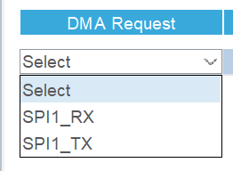

首先我们要选择的是此DMA通道用于干什么，SPI1_RX就是用于接收，TX是发送。

### DMA 配置项

选择后会出现一个看起来很复杂的界面，全都不需要改，但我们稍微了解一下，来一个一个看：

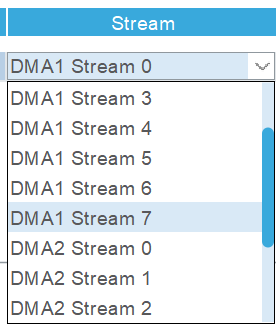

这里是选择DMA通道，这里SPI1可以使用DMA1，DMA2，各有8个通道，随便选，别用重了就行。

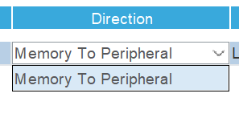

这里是选择搬运方向，图中显示“内存到外设”，这个不用管，选好第一个选项后MX自动配。

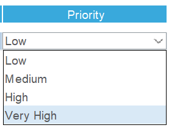

这是优先级，当一个DMA有多个通道都要搬消息，按这个裁决。同优先级的，通道标号小的先。

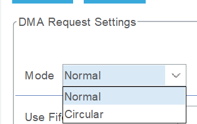

这里是选择模式，普通模式（Normal）就是一次函数只搬一轮，

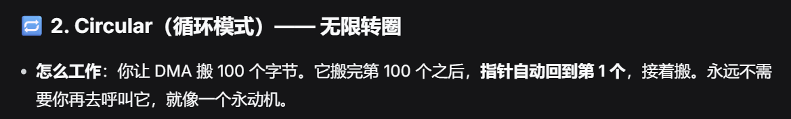

通常都是用普通模式。

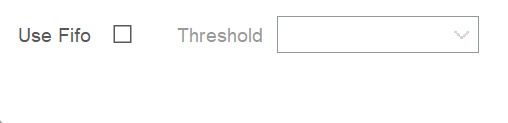

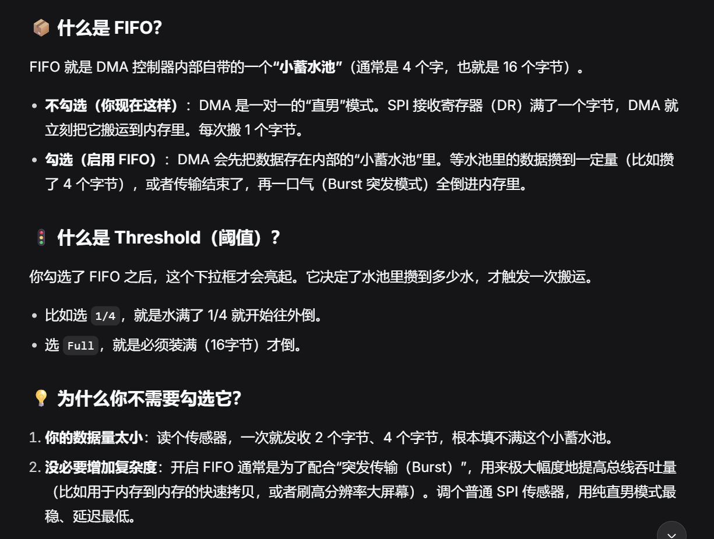

简单来说，FIFO可以在总线繁忙的情况下有效提高总线利用率，是传输大量数据的情况下可能会用到的，一般用不到，具体你再自己了解。

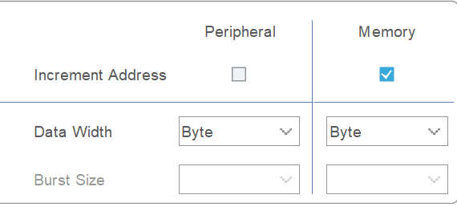

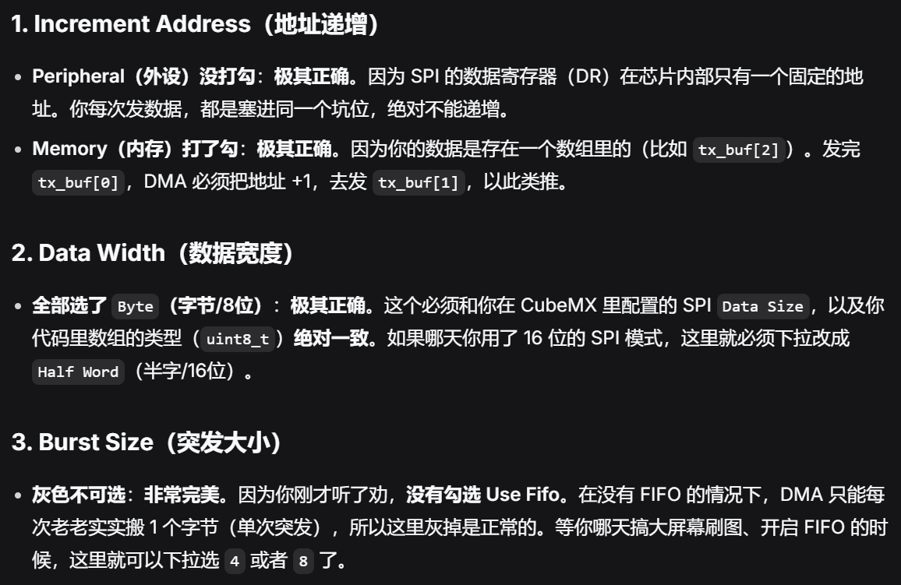

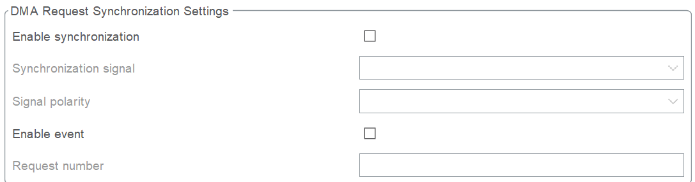

这是高级东西了，前面的区域，以后再来探索吧~

## 生成代码

Generate code！

然后函数就是把_IT换成_DMA，其他没什么。
